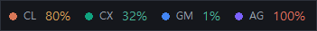

# AI Usage Board — 개발 문서

사용 방법은 [README](README.md)에 있다. 이 문서는 소스에서 실행·빌드·테스트하는 방법과
내부 동작, 설계 결정의 근거를 다룬다.

---

## 소스에서 실행

실행에 필요한 외부 패키지는 없다. 표준 라이브러리만으로 네 서비스가 모두 동작한다.

### 1. 바로 띄워 보기

```bash
py run.py
```

완전히 끄려면 설정 메뉴나 트레이 메뉴의 `종료`, 또는:

```bash
py run.py --quit
```

`--quit`는 프로세스를 죽이는 게 아니라 브리지로 **실행 중인 위젯에 종료를 요청**하고 포트가
풀릴 때까지 기다린다. 위젯만이 자기가 띄운 계정 브라우저를 닫을 수 있기 때문이다. 강제
종료하면 그 브라우저가 주인 없이 남는다.

이미 떠 있는데 다시 실행하면 새 창이 뜨지 않고 기존 창을 앞으로 가져온 뒤 그 사실을 알린다.

> CDP(DevTools 프로토콜)에 쓰는 WebSocket은 `providers/ws.py`에 직접 들어 있다. 루프백으로
> 작은 JSON 몇 개를 주고받는 게 전부여서 패키지를 요구할 이유가 없고, 설치가 빠지면
> 계정 연결이 조용히 실패하기 때문이다.

### 2. 콘솔 창 없이

```bash
pyw run.py
```

`pythonw`(`pyw`)로 띄우면 콘솔 창이 뜨지 않는다.

### 3. 배포용 exe

```bash
powershell -ExecutionPolicy Bypass -File build.ps1
```

결과물은 `dist\AIUsageBoard\AIUsageBoard.exe` (PyInstaller onedir, 약 28MB).
스크립트가 3.12 → 3.11 → 3.13 순으로 설치된 인터프리터를 찾아 가상환경을 만든다.

빌드가 끝나면 `LICENSE`가 `dist\AIUsageBoard\`에 함께 복사된다. 실행 중인 exe가 있으면
빌드를 시작하지 않는다 — `--clean`이 잠긴 파일만 남기고 나머지를 지워 버리기 때문이다.

---

## 동작 방식

서비스마다 사용량을 얻는 경로가 다르다. 네 경로 모두 **사용자가 이미 로그인한 세션**을 쓰고,
AI Usage Board는 자격 증명을 만들지도 보관하지도 않는다.

| 서비스 | 경로 | 요약 |
|---|---|---|
| Claude | 전용 Chrome/Edge + CDP | 로그인은 포트 없이, 조회는 화면 밖 창으로. 사용량 페이지에서만, 격리 world에서 리더 실행 |
| Codex | `codex app-server --stdio` | 공식 CLI를 자식 프로세스로 띄워 JSON-RPC `account/rateLimits/read` 호출 |
| Gemini | 전용 Chrome/Edge + CDP | Claude와 같은 경로, 프로필만 따로 |
| Antigravity | 로컬 language server | 앱이 띄운 서버에 `GetUserStatus` RPC 호출. 앱이 꺼져 있으면 그 서버를 3초간 직접 띄운다 |

Gemini도 Claude와 같은 전용 브라우저 경로를 쓴다. 임베디드 WebView는 Google이 로그인을 막고
추가 패키지도 필요하기 때문이다. 서비스별 차이(도메인, 사용량 경로, 로그아웃 판정)는
`providers/browser_account.py`의 `SITES` 한 곳에 있다.

### Antigravity: 남의 앱에 얹기

Antigravity는 사용량 페이지가 없다. 대신 IDE가 `language_server.exe`를 로컬에 띄우고,
에디터 자신이 그 서버에 플랜과 모델별 쿼터를 물어본다. 우리도 **같은 서버에 같은 질문**을
한다 (`providers/antigravity.py`).

```
POST https://127.0.0.1:<port>/exa.language_server_pb.LanguageServerService/GetUserStatus
x-codeium-csrf-token: <토큰>
{}
```

주소도 토큰도 고정이 아니다. 서버는 `--https_server_port 0`으로 떠서 실행할 때마다 포트가
바뀌고, CSRF 토큰도 매번 새로 생긴다. 그래서 둘 다 **실행 중인 프로세스에서 찾아낸다** —
PowerShell 한 번으로 `language_server` 프로세스 목록과 각자가 듣고 있는 루프백 포트를
받아 온 뒤, 명령줄의 `--csrf_token`을 읽고 포트를 하나씩 두드려 본다. 찾은 주소는 캐시하고,
호출이 실패하면 버리고 다시 찾는다. 평소 조회는 30ms, 재탐색이 필요할 때만 5초쯤 걸린다.

같은 바이너리를 Windsurf와 JetBrains Codeium 플러그인도 쓴다. **다른 계정의 쿼터를 읽으면
안 되므로** 명령줄의 `--app_data_dir antigravity`로 우리 것만 골라낸다 (`is_antigravity`).

응답은 protobuf 모양의 JSON이라 **값이 0인 필드는 아예 빠진다.** 그래서 `remainingFraction`이
없는 모델은 "모름"이 아니라 **다 쓴 것**이다. 다만 `quotaInfo`가 통째로 비어 있으면(`{}`)
반대 의미 — 추적 자체를 안 하는 모델이라 카드에서 뺀다. 아직 안 열린 Gemini 4 계열이 이렇게
온다. 둘을 구별하지 않으면 멀쩡한 모델이 100% 소진으로 보이거나 그 반대가 된다.

여러 모델이 쿼터를 공유하고, 응답은 그 사실을 **같은 숫자를 반복하는 것으로만** 알려 준다.
그래서 `(잔량, 리셋시각)`이 같은 모델을 한 칸으로 접고 `Gemini`, `Claude · GPT-OSS`처럼
집안 이름을 붙인다. 같은 집안이 두 칸으로 갈리면 그때만 모델명까지 쓴다.

### 앱이 꺼져 있을 때

Antigravity는 사용량 페이지가 없으므로, 앱이 꺼져 있으면 읽을 대상 자체가 없다 — 단 하나,
**앱이 띄웠을 바로 그 프로그램**만 빼고. 그래서 `language_server.exe`를 앱과 같은 방식으로,
같은 계정 디렉터리에 대고 직접 띄워 한 번 묻고 바로 내린다 (`launch_and_read`). 살아 있는
시간은 약 3초다. 이미 서버가 떠 있으면 이 경로로 오지 않으므로 앱 옆에 두 번째 서버가
생기는 일은 없다.

인자 두 개가 장식이 아니다. **`--enable_sidecars`와 `--override_ide_version` 중 하나라도
빠지면 백엔드가 Gemini 그룹의 쿼터를 통째로 빼고 답한다** — 실측으로 둘 다 주면 모델 9개에
수치 6개, 하나라도 빠지면 6개에 3개다. 카드가 한도를 조용히 잃으면 "한도 없음"처럼 보이기
때문에, 버전을 읽지 못하면 아예 띄우지 않고 "앱을 켜면 표시됩니다"라고 말한다. 버전은
자동 업데이트마다 바뀌므로 설치된 `Antigravity.exe`의 파일 버전에서 읽는다 (`app_version`).

수치는 한꺼번에 오지 않는다. Claude 그룹이 먼저 답하고 Gemini가 조금 뒤에 채워져서, 처음
받은 응답을 그대로 쓰면 아직 오지 않은 그룹이 빠진다. 그래서 **수치 개수가 더 늘지 않을
때까지** 기다린다 (`SETTLE_POLLS`). 전체 3초쯤 걸린다.

주기도 따로 간다. 앱이 떠 있으면 1분, 직접 띄워야 하면 **10분**이다 — 200MB짜리 바이너리를
1분마다 올렸다 내릴 일은 아니다. `다시 시도`나 `전체 새로고침`은 주기와 무관하게 즉시 읽는다.

### 창 크기

창 크기는 **고정**이다. 가로는 `WINDOW_WIDTH`, 세로는 내용에 맞춰 자동으로 맞춰진다
(`_fit`). 사용자가 끌어서 바꾸지 않는다 — 임의 크기를 허용하면 스크롤 영역이 필요해지고,
거기서 생기는 여백과 표시줄이 이 위젯의 차분한 인상을 깬다.

전체 크기는 `theme.UI_SCALE` 하나로 조절한다. 이 값은 간격·기하·타이포에 **함께** 곱해지므로
비율이 틀어지지 않는다. 1.0이 설계 기준 크기이고 현재는 `0.90`이다.

```python
UI_SCALE = 0.90
def set_scale(dpi_factor):           # 디스플레이 배율 × UI 배율
    _scale = max(0.5, min(4.0, dpi_factor * UI_SCALE))
```

픽셀 값은 전부 `px()`를 거치고, 포인트 단위 폰트는 Tk의 `tk scaling`에 같은 값을 넘겨
따라가게 했다. 더 크게/작게 쓰고 싶으면 이 상수만 바꾸면 된다.

### 카드의 세로 리듬

카드 안의 세로 간격은 기본 간격 척도(`SPACE_*`)와 따로 둔다 (`CARD_PAD_Y`, `ROW_GAP`,
`METER_GAP`, `META_GAP`, `CARD_GAP`). 카드 넷이 한 화면에 들어가도록 세로만 촘촘하게 잡은
눈금이다. 네 카드를 모두 펼친 창은 125% 배율 화면에서 342×851px다.

**세로만 좁다.** 가로 거터는 `SPACE_3`이다 — `_card_inner_width()`가 거기서 나오고 모든
미터가 그 폭으로 그려진다. 글자 크기도 기본 그대로다. `UI_SCALE`을 낮추면 타이포까지 같이
작아지기 때문에 높이를 줄이는 수단으로는 쓰지 않는다.

미터 아래에는 리셋 시각 줄이 있다. 언제 초기화되는지는 이 위젯을 보는 이유 중 하나다.

카드 맨 아래 줄은 **할 말이 있을 때만** 그린다 — 오류 문구(`Antigravity가 실행 중이
아닙니다`), `오래된 정보` 꼬리표, Antigravity의 요금제(`Antigravity Starter Quota`). 수치의
출처처럼 카드 제목이 이미 말하는 내용은 쓰지 않는다. `providers`와 `extractor.js`도 정상일
때는 그 줄에 넣을 문구를 만들지 않는다.

### 창 위치와 다중 모니터

창 위치는 **가상 데스크톱 전체**를 기준으로 자른다 (`win32.virtual_screen`,
`clamp_to`). Tk의 `winfo_screenwidth`/`winfo_screenheight`는 주 모니터 하나만 말해 주고,
데스크톱은 (0, 0)에서 시작하지도 않는다 — 주 모니터보다 위에 놓인 모니터는 **음수 y**를
갖는다.

그래서 `max(0, ...)`로 자르면 안 된다. 세 모니터가 이렇게 놓인 환경에서

```
주 모니터  (0, 0)-(2560, 1600)
2번       (2560, -10)-(4480, 1070)
3번       (4480, -19)-(6400, 1061)
```

주 모니터 기준으로 자르면 3번 모니터에 둔 창은 그 모니터 맨 위에서 **19px 아래**까지만
올라가고, 2번·3번 모니터에서 닫은 창은 다음 실행 때 주 모니터로 끌려온다. 테스트가 이 배열을
그대로 고정값으로 쓴다.

`_fit`이 창을 작업 표시줄 위로 밀어 올릴 때 쓰는 기준도 주 모니터 높이가 아니라 **그 창이
실제로 올라가 있는 모니터의 작업 영역**이다 (`work_area_at`).

클램프 기준이 모니터 하나가 아니라 전체를 감싸는 사각형이므로, 주 모니터에서는 반대로
위로 19px만큼 더 밀어 넣을 수 있다. 그만큼이 화면 밖으로 나가지만 창을 가장자리에 숨겨
두는 쓰임이 있어서 그대로 뒀다.

### 작업 표시줄 막대

설정 메뉴의 `작업 표시줄 막대`를 켜면 가로로 긴 요약 창이 하나 더 뜬다 (`ui/strip.py`).
서비스마다 점 · 약칭 · **가장 많이 쓴 창의 %** 하나씩, 한 줄이다. 실측 351×35px.



Windows 11은 프로그램이 작업 표시줄 **안에** 내용을 넣던 deskband API를 없앴고 대체물을
내놓지 않았다. 그래서 이것은 그 아이디어의 정직한 버전이다 — 작업 표시줄이 아니라, 그
바로 위 작업 영역(`cursor_work_area`)에 붙는 **별도의 최상위 창**이다. 작업 표시줄인 척하지
않는다.

끌어서 옮길 수 있고 위치는 `settings.json`의 `strip_x` / `strip_y`에 남는다. 더블클릭하면
본체 창이 마우스가 있는 화면으로 올라온다. 1초마다 도는 틱에서 매번 다시 그리면 깜빡이고
드래그와 싸우므로, 수치가 실제로 바뀌었을 때만 다시 그린다.

### 계정 연결의 두 단계 (Claude · Gemini)

로그인과 조회는 서로 반대되는 것을 원한다. 조회에는 DevTools 포트가 필요하지만, 로그인
화면에서는 그 포트가 **없을수록** 좋다. 그래서 단계를 나눴다 (`browser_account.run`).

| 단계 | 디버깅 포트 | 창 | 하는 일 |
|---|---|---|---|
| 로그인 | **없음** | 보임 | 아무것도 안 함. 사용자가 직접 로그인 |
| 조회 | 있음 | **화면 밖**(Claude) · **숨김**(Gemini) | 사용량 페이지에서만 리더 실행 |

조회용 브라우저는 보라고 있는 창이 아니라 설비다. 그래서 사용자 눈에는 띄지 않게 둔다.
다만 Claude의 조회 창은 **숨기지는 않는다.** 창은 "보이는" 상태 그대로 **가상 데스크톱 왼쪽 바깥**에 세워 두고,
`WS_EX_TOOLWINDOW`로 작업 표시줄과 Alt+Tab에서 뺀다 (`BrowserSession.hide` → `_tuck`,
`parking_spot`). 화면에 두는 창은 로그인 단계 하나뿐이다. **프로세스는 계속 살아 있어야
한다** — CDP로 읽을 대상이 사라지기 때문이다.

예전에는 `ShowWindow(SW_HIDE)`로 완전히 숨겼다. 그런데 숨긴 창(최소화도 같다)의 페이지는
`document.visibilityState`가 `hidden`이 되고 `requestAnimationFrame`이 멈춘다. 그 상태에서는
Cloudflare 확인(Turnstile)이 **끝날 수가 없다** — 약 2분마다 시간 초과로 다시 시작하고, 그
실패가 쌓이면 사이트가 프로필 자체를 믿지 않게 된다. 실제 프로필 기록에서 확인 한 번 뒤로
5시간 동안 2분 18초 간격의 재시도만 남아 있었다. 같은 플래그로 실측하면 최소화한 창은
`hidden`·rAF 1회, 화면 밖 창은 `visible`·rAF 초당 60회다. 화면 밖 창이 숨김으로 처리되지 않는
것은 `--disable-backgrounding-occluded-windows` 덕분이다. 이제 페이지 입장에서는 평범하게
열려 있는 탭이라, 확인이 떠도 여느 브라우저처럼 저절로 통과한다.

**이 방식은 Claude에만 쓴다** (`Site.park_visible`). 보이는 페이지는 계속 그려지기 때문이다.
실측으로 화면 밖에 둔 Claude 사용량 페이지는 30초에 렌더러 CPU 0.05초로 조용했지만, Gemini
사용량 페이지는 1분에 렌더러 6초 · GPU 2초(코어 하나의 10%쯤)를 계속 썼다. Gemini에는
Cloudflare 확인이 없으니 그 비용을 낼 이유가 없어서, 예전처럼 `SW_HIDE`로 숨긴다.

한 번 세워 두고 끝이 아니라 폴링마다 `keep_hidden()`이 확인해서, 창이 화면 안으로 돌아왔거나
최소화됐거나 작업 표시줄에 다시 나타났으면 도로 세운다. Chrome은 탭을 새로 열거나 복구할 때,
디스플레이 구성이 바뀔 때 창을 옮기기 때문이다. 창을 앞으로 가져와야 할 때(`창 열기`)는
`reveal()`이 원래 자리와 작업 표시줄로 되돌린다 (`_bring_home`). 닫기 직전에도 숨긴 채로 원래
자리로 옮겨 둔다 — Chrome이 마지막 창 위치를 프로필에 저장하고, 같은 프로필이 다음에는 로그인
창으로 열리기 때문이다.

리더는 **격리 world**에서 돈다 (`BrowserSession.evaluate_isolated` — `Page.getFrameTree` →
`Page.createIsolatedWorld` → `Runtime.evaluate(contextId)`를 연결 하나로). DOM은 같이 보지만
자바스크립트는 페이지와 섞이지 않는다. 페이지 쪽 world에서 돌던 시절에는 15초마다
`window.AIUsageBoardReader` 전역이 페이지에 남았고, 낯선 전역은 봇 탐지가 찾는 전형적인
자동화 흔적이다.

실행 전에는 프로필의 `exit_type`을 `Normal`로 고쳐 둔다 (`_mark_clean_exit`).
"페이지를 복원하시겠습니까?" 버블이 뜨면 창이 도로 튀어나오기 때문이다.

Chrome은 몇 분 동안 화면에 보이지 않은 페이지를 거의 멈춰 세운다. 그 상태에서는 CDP 호출
하나에 1분 가까이 걸려 읽기가 매번 시간 초과로 끝난다. 그래서 조회용 브라우저만
`--disable-renderer-backgrounding`, `--disable-background-timer-throttling`,
`--disable-backgrounding-occluded-windows`와 `IntensiveWakeUpThrottling` 끄기를 붙여 띄운다
(`browser_command`). 로그인 창에는 붙이지 않는다. 수치가 최신인지 확실히 하려고 5분마다
사용량 페이지를 `Page.reload` 하기도 한다 (`RELOAD_SECONDS`). 예전에는 60초마다였는데, 새로
고칠 때마다 Cloudflare를 다시 지나가야 하고 하루 종일 1분 박자로 새로 고치는 브라우저는 봇처럼
보여서 줄였다. `전체 새로고침`은 주기와 상관없이 바로 새로 고친다.

단, **보안 확인 페이지에서는 절대 새로고침하지 않는다.** 확인 페이지는 주소가 사용량 페이지와
같아서, 새로고침하면 확인이 처음부터 다시 시작되고 디버거가 붙어 끝나지 않는다.

보안 확인이 떠도 **창을 스스로 띄우지 않는다.** 대부분은 몇 초 안에 저절로 통과하므로
20초(`CHALLENGE_GRACE_SECONDS`) 동안 기다렸다가, 그래도 남아 있으면 카드에만 알리고
`창 열기` 버튼을 보여 준다. 창은 사용자가 그 버튼을 눌렀을 때만 나온다. 확인이 끝나 수치를
다시 읽으면 창은 자동으로 화면 밖으로 돌아간다.

헬퍼는 브리지 응답이 **연속 20번** 실패해야 종료로 판단한다 (`BridgeClient.GIVE_UP_AFTER`).
한 번의 실패로 끝내면 위젯이 막 뜨는 동안 헬퍼가 죽고 브라우저만 주인 없이 남는다.

로그인 단계의 브라우저는 포트가 없으니 붙을 수단 자체가 없다. 관찰 가능한 어떤 방법으로도
평범한 브라우저와 구분되지 않는다. 사용자가 로그인을 마치고 카드의 `로그인 완료`를 누르면
창을 **WM_CLOSE로 정상 종료**한다 — 강제 종료하면 쿠키가 디스크에 안 남아 방금 한 로그인이
날아가기 때문이다. 그다음 같은 프로필을 포트와 함께 다시 연다.

조회 중 로그인이 풀리면(Claude는 `/login`, Gemini는 `accounts.google.com`으로 가면)
`connected` 표식을 지우고 로그인 단계로 되돌아간다. 로그인 페이지를 계속 긁는 대신.
카드가 `계정 연결 필요`일 때 `계정 연결`을 눌러도 같은 일이 일어난다 — 조회용 창에서
로그인시키지 않는다.

**CDP는 사용량 페이지에서만 붙는다** (`on_usage_page`). 로그인·보안 확인 페이지에는 붙지
않고, 창을 앞으로 가져오는 것도 CDP가 아니라 Win32로 한다.

브라우저에 넘기는 플래그는 최소한으로 유지한다. 특히 `--disable-blink-features=`
`AutomationControlled`는 **일부러 쓰지 않는다.** 디버깅 포트만으로는 `navigator.webdriver`가
이미 false라 얻을 게 없는 반면, Chrome이 "지원되지 않는 명령줄 플래그" 경고 막대를 띄우고,
그 플래그 자체가 봇 탐지가 찾는 우회 신호다. 평범해 보여야 하는 창에 둘 다 손해다.

### 카드 순서

기본 순서는 **Claude → Codex → Gemini → Antigravity**다. 연결된 서비스가 앞으로 올라오고,
나머지는 기본 순서를 그대로 유지한다. Gemini만 연결되어 있으면
Gemini → Claude → Codex → Antigravity가 된다.

분할은 **안정적(stable)** 이다. 카드는 서비스가 실제로 연결되거나 끊길 때만 움직이고,
새로고침 타이밍이 엇갈렸다고 자리를 바꾸지 않는다. 바탕화면에 상주하는 창에서 카드가
깜빡일 때마다 자리를 옮기면 읽을 수가 없기 때문이다.

"연결됨"의 판정은 네 서비스 모두 동일하다 — **보여 줄 수치를 가지고 있으면 연결된 것**이다
(`Widget._connected`). Codex와 Antigravity에는 상태를 보고할 계정 창이 없고, 캐시된 수치도
계정이 붙어 있다는 뜻이므로 이 기준 하나로 통일했다. 계정 관리자가 `connected`라고 보고한 서비스도
포함해서, 아직 결과가 없는 갱신 중에 카드가 도로 내려가지 않게 했다.

규칙 자체는 `core/models.py`의 `order_services()`에 있고, 재배치는 `ui/widget.py`의
`_reorder()`가 담당한다.

갱신 주기는 Codex 15초, Claude·Gemini는 15초마다 읽고 페이지는 5분마다 새로 고친다. Antigravity는 앱이 떠 있으면 1분, 서버를
직접 띄워야 하면 10분으로 스스로 늦춘다. 왼쪽 아래 톱니바퀴 → `전체 새로고침`은 주기와
무관하게 즉시 읽는다.

### 설정 메뉴

상태줄 왼쪽의 톱니바퀴를 누르면 작은 메뉴가 위로 열린다 (`Widget.open_settings`).

* `전체 새로고침` · `연결 안내` · `문의하기` — 누르면 실행하고 메뉴가 닫힌다. `문의하기`는 문의 안내 페이지
  (`contact.html`)를 연다. 거기서 GitHub Issues(`config.new_issue_url()`)나 메일(`CONTACT_EMAIL` — 주소 복사,
  Gmail 웹 작성 화면, 메일 앱)로 문의한다. Issues 본문과 메일 본문 맨 아래에는 `ver 1.1.3`처럼 앱 버전만 채운다.
  연결 안내문의 `문의 · 버그 신고` 칸은 같은 폴더의 `contact.html`로 링크한다. 두 페이지 모두
  `config.prepare_user_files()`가 `{{...}}` 자리를 채워 데이터 폴더에 쓴다. 데이터 폴더(`{{DATA_FOLDER}}`)는
  실행한 PC의 실제 경로로 채운다 — 탐색기 주소창에 그대로 붙여 넣을 수 있게. 이슈·메일 본문에는 경로를 넣지
  않는다(버전만).
* `표시할 서비스` — Claude / Codex / Gemini / Antigravity 카드를 하나씩 켜고 끈다. 여러 개를 연달아
  바꿀 수 있도록 메뉴는 열린 채로 남는다. 선택은 `settings.json`의 `hidden`에 바로 저장된다.

* `보기` — `작업 표시줄 막대`를 켜고 끈다 (`settings.json`의 `strip`). 막대는 본체와
  별개로 떠 있어서, 본체를 트레이로 보내도 남는다.

* `테마` — 자동(Windows 설정) / 라이트 / 다크. 누르는 즉시 창 전체를 새 색으로 다시 그린다
  (`Widget.set_theme`). Tk 위젯은 만들 때 색이 정해지므로 내용 트리를 통째로 다시 만들고,
  카드는 저장소에서 다시 그리기 때문에 잃는 것은 없다. `settings.json`의 `theme`에 저장된다.

숨긴 서비스는 카드뿐 아니라 접힌 한 줄 요약과 트레이 툴팁에서도 빠진다. 숨긴 Codex는
CLI 폴링도 멈추고, 다시 켜는 순간 한 번 조회한다. Claude·Gemini 헬퍼는 로그인 상태를
지키기 위해 그대로 둔다.

메뉴는 Tk의 기본 메뉴가 아니라 직접 그린 `Popover`다. Windows의 기본 메뉴는 색 지정을
무시해서 다크 테마에서도 밝게 뜨기 때문이다. 바깥 클릭, `Esc`, 다른 앱으로 포커스가
넘어가면 닫힌다.

### 프로세스 구조

```
AIUsageBoard.exe  (위젯 · Tk)
├─ bridge  127.0.0.1:47319       토큰 인증 로컬 HTTP
├─ thread  codex-quota           codex CLI 호출
├─ thread  antigravity-quota     로컬 RPC · 필요하면 language server를 잠깐 띄움
└─ child   AIUsageBoard.exe --account-window claude --hidden
    child  AIUsageBoard.exe --account-window gemini --hidden
```

브라우저를 다루는 코드는 전부 **자식 프로세스**에 있다. 페이지가 멈추거나 브라우저가
죽어도 위젯은 영향을 받지 않는다. 자식은 브리지로 상태와 스냅샷을 올리고,
`show / refresh / close` 카운터를 폴링해서 부모의 지시를 받는다.

### 브리지 방어선

`src/ai_usage_board/bridge/server.py`

* `127.0.0.1` 바인드 — 외부에서 도달 불가
* `Authorization: Bearer <64 hex>` · `secrets.compare_digest` 비교
* `Host` 헤더가 `127.0.0.1:<포트>` 가 아니면 403 (DNS rebinding 차단)
* `Origin` 헤더가 붙은 요청은 거부 — 헬퍼는 보내지 않으므로, 붙어 있다면 브라우저 페이지에서 온 것이다
* 본문 16 KB 상한, 모든 페이로드는 `validate_snapshot()` 통과 필수

### 신뢰 경계

외부에서 들어오는 데이터는 세 군데다 — 자식 CLI의 stdout, 페이지에서 평가한 스크립트의
반환값, 브리지 POST 본문. 전부 `core/models.py`의 `validate_snapshot()` 하나를 거친다.
이 함수는 들어온 dict를 믿지 않고 **새 dict를 다시 만든다**. 모르는 키는 통과하지 못한다.

---

## 디자인

위젯은 바탕화면 위에 상주한다. 그래서 "눈에 띄는 것"이 아니라 **조용히 읽히는 것**이 목표다.

* **색은 의미에만 쓴다.** 서비스 구분은 8px 점 하나, 나머지 구조는 전부 중립색.
  게이지는 사용량이 65%를 넘으면 주황, 90%를 넘으면 빨강으로 바뀐다. 그 전까지는 차분한 녹색.
* **그림자 대신 1px 헤어라인.** 카드는 테두리 프레임 + 1px 안쪽 프레임으로 만든다
  (`ui/components.py`의 `Card`).
* **4px 간격 체계.** 창과 메뉴는 `SPACE_1..5`만 쓴다. 카드 안의 세로 간격만 예외로
  자체 눈금(`CARD_PAD_Y` · `ROW_GAP` · `METER_GAP` · `META_GAP` · `CARD_GAP`)을 쓴다 —
  카드 넷이 한 화면에 들어가도록 세로만 촘촘하게 잡았다.
* **타입 스케일 5단계.** 제목 / 서비스명 / 수치 / 라벨 / 메타. 굵게는 제목과 수치에만.
* **라이트·다크 자동.** 레지스트리의 `AppsUseLightTheme`을 읽는다 (`theme.resolve`).
* **DPI 인식.** 프로세스를 per-monitor v2로 올리고 모든 픽셀 값을 `theme.px()`에 통과시킨다.
  125 / 150% 환경에서 흐려지지 않는다.

토큰은 전부 `src/ai_usage_board/theme.py` 한 파일에 있다. 팔레트를 바꾸면 전체가 따라온다.

---

## 레이아웃

```
src/ai_usage_board/
├── __main__.py          진입점 · 위젯/헬퍼 프로세스 분기
├── config.py            경로 · 설정 · 단일 인스턴스 뮤텍스
├── autostart.py         Windows 시작 시 실행 (시작 프로그램 폴더 바로 가기)
├── theme.py             디자인 토큰 · DPI 스케일
├── core/
│   ├── models.py        서비스 레지스트리 · validate_snapshot
│   └── store.py         스냅샷 저장소 · 캐시
├── providers/
│   ├── codex.py         codex CLI JSON-RPC
│   ├── antigravity.py   로컬 language server RPC · 앱 없이 읽기
│   ├── chrome_session.py  CDP 세션 (루프백 검증 포함)
│   ├── browser_account.py Claude · Gemini 헬퍼 루프 (SITES)
│   ├── ws.py            최소 WebSocket 클라이언트 (CDP 전용)
│   └── manager.py       헬퍼 프로세스 감독
├── bridge/
│   ├── server.py        로컬 HTTP 제어 평면
│   └── client.py        헬퍼용 클라이언트
├── ui/
│   ├── widget.py        메인 창
│   ├── strip.py         작업 표시줄 막대
│   ├── components.py    Card · Meter · GhostButton · Dot · Popover
│   └── win32.py         DPI · 둥근 모서리 · 트레이 아이콘 · 모니터 기하
└── resources/
    ├── extractor.js     페이지 리더 (읽는 범위가 코드에 명시됨)
    ├── connect-guide.html
    ├── contact.html     문의 안내 (GitHub Issues · 메일)
    └── app.ico          tools/make_icon.py 로 생성
```

사용자 데이터는 전부 `%LOCALAPPDATA%\AIUsageBoard` 한 폴더에 들어간다.
설정, 캐시, 브리지 토큰, 브라우저 프로필, 로그. 지우려면 이 폴더만 삭제하면 된다.
레지스트리에는 아무것도 쓰지 않는다.

예외는 하나, 사용자가 `Windows 시작 시 실행`을 켰을 때 시작 프로그램 폴더에 두는
`AI Usage Board.lnk`다. 레지스트리 `Run` 키 대신 바로 가기를 쓰는 이유는 위의 약속을 지키면서
사용자가 탐색기에서 직접 보고 지울 수 있게 하기 위해서다. 켜짐 여부는 settings.json이 아니라
이 파일이 있는지로 판단한다 — 손으로 지우거나 작업 관리자에서 끈 것도 메뉴에 그대로 반영된다.
바로 가기는 셸의 ShellLink COM 객체를 ctypes로 직접 불러 만든다 (추가 패키지 없음,
PowerShell 창 깜빡임 없음). 소스에서 켜면 `pythonw run.py`를, exe에서 켜면 그 exe를 가리킨다.

---

## 테스트

```bash
py -m pip install pytest
```

```bash
py -m pytest -q
```

129개다. 검증기(주입 페이로드 거부, 거짓 시계 무시), 저장소(재적재), 브리지(토큰 / Host /
Origin 거부), Codex CLI 탐색, 페이지 리더(Node로 실제 실행, 없으면 건너뜀), 조회용 브라우저
플래그, 그리고 Antigravity 쪽이 가장 두껍다 — 서버 판별, 응답 해석의
함정(빈 `quotaInfo`와 0의 차이, NaN), 루프백 강제와 리다이렉트 차단, 앱 없이 띄울 때의
필수 인자까지 덮는다. 창 배치는 실제 다중 모니터 배열을 고정값으로 넣어 검증한다.

---

## 확장 포인트

* **서비스 추가** — `core/models.py`의 `SERVICES`에 항목을 넣고, `providers/`에 읽기 경로를
  하나 추가한다. 웹 페이지에서 읽는 서비스라면 `extractor.js`의 `PAGES`와
  `browser_account.py`의 `SITES`에 항목을 하나씩 더한다. UI는 자동으로 카드를 하나 더 그린다.
* **알림** — `UsageStore.update()`에서 임계값을 넘길 때 트레이 풍선이나 토스트를 띄우면 된다.
  이전 스냅샷이 아직 손에 있는 유일한 지점이다.
* **기록** — 스냅샷을 SQLite에 누적하면 추세 그래프를 붙일 수 있다. `store.py`가 유일한 쓰기 지점이다.

---

## 문제 해결의 내부 사정

**Codex 카드가 "연결이 종료됐습니다"로 뜰 때** — `codex` CLI를 못 찾은 것이다. Codex 데스크톱
앱은 GUI 실행파일(`app\Codex.exe`)과 CLI(`app\resources\codex.exe`)를 함께 담고 있는데,
이름만 보고 고르면 GUI를 집어서 `app-server` 인자를 무시하고 즉시 죽는다. 그래서
`find_codex()`는 후보의 **PE 서브시스템 헤더를 읽어** 콘솔 프로그램(subsystem 3)만 받아들인다
(`is_console_executable`). 실행해서 확인하지 않는 이유는, GUI였을 경우 사용자 화면에 창이
떠버리기 때문이다.

**Claude 카드가 "보안 확인 필요"로 뜰 때** — Cloudflare가 사람 확인을 요구하는 상태다.
카드의 `창 열기`를 눌러 숨어 있던 전용 브라우저 창을 띄우고, 체크박스를 직접 눌러 주면 된다.
통과하면 창은 저절로 다시 숨는다.

이때 앱은 **자동 이동을 멈춘다.** 확인 페이지나 로그인 폼에서 페이지를 다시 불러오면 사용자가
진행하던 것이 날아가기 때문이다. 자동으로 사용량 화면으로 보내는 동작은 `SAFE_TO_LEAVE`에
있는 경로(`/`, `/new`, `/chats`, `/recents`)에서만 일어난다.

**보안 확인이 아무리 해도 끝나지 않을 때** — 그 브라우저 프로필 자체가 찍힌 것이다. 확인
페이지를 반복해서 새로 불러왔거나 브라우저가 여러 번 강제 종료되면 이렇게 된다. 같은 플래그로
새 프로필을 띄우면 바로 통과하는 것으로 확인했다. 가장 흔한 원인은 **숨긴 창에서 확인이 돌던
것**이었다 — 끝날 수 없는 확인이 2분마다 다시 시도되며 실패를 쌓았다. 조회 창을 화면 밖에
"보이는" 채로 두게 바꾼 뒤로는 이 경로가 막혔다 (위 "계정 연결의 두 단계" 참고).

고치는 방법은 프로필을 버리는 것뿐이다. 사용자가 이 상황을 알아채고 트레이 메뉴까지 찾아가길
기대할 수는 없으니 앱이 알아챈다 (`ChallengeWatch`). `창 열기`로 창을 띄운 뒤 2분
(`STUCK_AFTER_REVEAL_SECONDS`)이 지나도 확인이 남아 있거나, 수치를 한 번도 못 읽은 채 확인이
3번(`STUCK_AFTER_CHECKS`) 다시 뜨면 `verify_stuck` 상태가 되고 카드 버튼이 **`다시 연결`**로
바뀐다. 누르면 `accounts\claude\browser` 폴더를 지우고 바로 로그인 창을 연다
(`Widget.reset_account` → `AccountManager.reset` + `connect`). 트레이 메뉴의 `Claude 다시 연결`도
같은 동작이다. 열려 있던 창은 닫지 않으므로, 그 사이 확인이 통과되면 수치는 그대로 다시 들어온다.

**로그가 필요하면** `%LOCALAPPDATA%\AIUsageBoard\runtime.log`를 본다. 헬퍼 프로세스가 죽은
경우에만 기록된다.

---

## 보안 메모

* Claude·Gemini 조회용 브라우저는 **원격 디버깅 포트**(랜덤, 127.0.0.1 전용)로 열린다.
  같은 사용자 권한의 다른 로컬 프로세스는 그 포트에 접근할 수 있다. 일상용 프로필과는 분리되어 있다.
* 브리지 토큰 파일도 같은 사용자 권한이면 읽을 수 있다. 둘 다 원격 노출은 아니다.
* 표시 값은 토큰 개수가 아니라 서비스가 공개하는 **사용 비율**이다. 남은 양이 아니라
  쓴 양이므로, 숫자가 커질수록 여유가 없다는 뜻이다.
* 서비스가 사용량 페이지 구조를 바꾸면 리더가 수치를 못 찾을 수 있다.
  그때는 `resources/extractor.js`의 선택자만 고치면 된다.
* Antigravity 앱이 꺼져 있으면 위젯이 **그 앱의 language server를 약 3초간 직접 띄운다**.
  같은 계정 디렉터리를 쓰고 끝나면 종료한다. 이미 서버가 떠 있으면 띄우지 않는다.

---

## 라이선스

[MIT License](LICENSE) · Copyright (c) 2026 jaehoon
