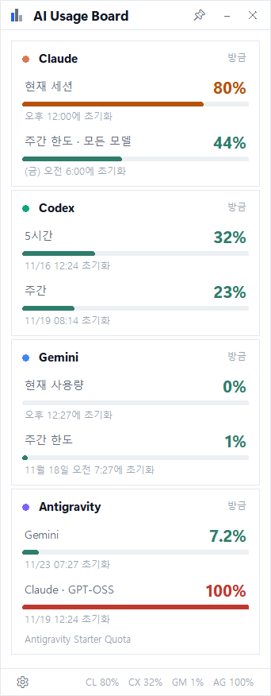
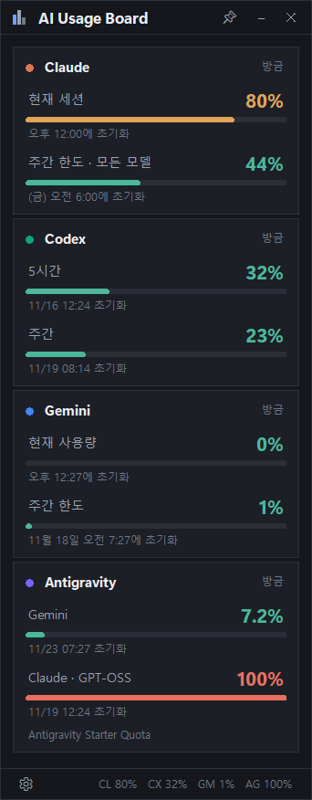
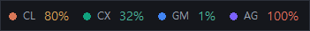

# AI Usage Board

Codex · Claude · Gemini · Antigravity를 얼마나 썼는지 **한 창에서** 보여 주는 Windows 데스크톱 위젯입니다.
사이트마다 사용량 화면을 찾아 들어가지 않아도, 바탕화면 한쪽에서 남은 한도와 초기화 시각을 바로 확인할 수 있습니다.

| 라이트 | 다크 |
|---|---|
|  |  |

---

## 주요 기능

- **네 서비스를 한눈에** — Codex, Claude, Gemini, Antigravity의 사용 비율을 카드별 막대로 보여 줍니다.
  세션 한도·주간 한도처럼 서비스가 나눠 두는 한도는 막대를 따로 그립니다.
- **초기화 시각 표시** — 막대마다 언제 한도가 다시 채워지는지 함께 나옵니다.
- **색으로 보는 여유** — 65% 이상이면 주황, 90% 이상이면 빨강으로 바뀝니다. 10분 넘게 새 값을
  받지 못하면 회색으로 바뀌고 `오래된 정보`가 붙습니다.
- **자동 갱신** — 켜 두기만 하면 알아서 다시 읽습니다. ([갱신 주기](#갱신-주기))
- **작업 표시줄 막대** — 작업 표시줄 바로 위에 서비스별 사용률을 한 줄로 띄워 둘 수 있습니다.

  

- **접기 · 항상 위 · 트레이** — 창을 한 줄로 접거나, 다른 창 위에 고정하거나, 트레이로 숨길 수 있습니다.
- **라이트 / 다크 테마** — Windows 설정을 따르거나 직접 고를 수 있습니다.
- **필요한 서비스만** — 쓰지 않는 서비스의 카드는 숨길 수 있습니다.
- **내 PC 안에서만** — 이미 로그인해 둔 세션으로 읽기만 하고, 읽은 내용을 외부로 보내지 않습니다.
  ([개인정보와 보안](#개인정보와-보안))

---

## 설치

### 필요한 것

- Windows 10 또는 11 (64비트)
- 쓰려는 서비스에 따라:

| 서비스 | 필요한 것 |
|---|---|
| Codex | Codex 앱, 또는 `npm i -g @openai/codex`로 설치한 Codex CLI |
| Claude · Gemini | Chrome 또는 Edge (위젯 전용 프로필을 따로 만들어 씁니다) |
| Antigravity | 로그인해 둔 Antigravity 앱 |

### 설치하기

1. [Releases](https://github.com/jaehoonV/AI-Usage-Board/releases/latest)에서
   `AIUsageBoard-<버전>-win64.zip`을 받습니다.
2. 원하는 곳에 압축을 풉니다.
3. `AIUsageBoard\AIUsageBoard.exe`를 실행합니다.

> 처음 실행할 때 "Windows의 PC 보호" 창이 뜰 수 있습니다. 서명되지 않은 프로그램이라 뜨는
> 안내입니다. `추가 정보` → `실행`을 누르면 됩니다.

설치 프로그램은 따로 없고, 압축을 푼 폴더가 곧 프로그램입니다. 이미 실행 중일 때 다시
실행하면 새 창을 띄우지 않고 기존 창을 앞으로 가져옵니다.

**Windows를 켤 때 자동으로 실행하려면** `Win + R` → `shell:startup`을 입력해 열린 폴더에
`AIUsageBoard.exe`의 바로 가기를 넣어 두세요.

---

## 서비스 연결

한 번 연결해 두면 위젯을 다시 켜도 그대로 이어집니다. 설정 메뉴의 `연결 안내`에서도 같은
내용을 볼 수 있습니다.

### Codex

Codex에 이미 로그인해 두었다면 할 일이 없습니다. 카드에 바로 숫자가 나옵니다.
카드에 `계정 연결`이 보이면 누르세요. Codex의 OpenAI 로그인 페이지가 기본 브라우저에 열립니다.

### Claude · Gemini

1. 카드의 `계정 연결`을 누릅니다. Chrome(없으면 Edge) 창이 하나 뜹니다.
   평소 쓰는 브라우저와 섞이지 않는 **위젯 전용 프로필**입니다.
2. 그 창에서 평소처럼 로그인합니다.
3. 위젯 카드로 돌아와 `로그인 완료`를 누릅니다.

창이 닫히고, 그 뒤로는 보이지 않는 곳에서 사용량 화면만 읽습니다.

### Antigravity

할 일이 없습니다. Antigravity에 로그인해 둔 PC라면 카드가 알아서 채워집니다.
앱이 꺼져 있어도 위젯이 잠깐(약 3초) 확인하고 바로 정리합니다.

---

## 사용법

### 창

| 위치 | 버튼 | 하는 일 |
|---|---|---|
| 위 | 📌 / 📍 | 다른 창 위에 항상 띄우기 켜기 / 끄기 |
| 위 | `–` / `+` | 카드를 접어 한 줄 요약만 보기 / 다시 펼치기 |
| 위 | `✕` | 트레이로 숨기기 (종료가 아닙니다) |
| 아래 왼쪽 | ⚙ | 설정 메뉴 |
| 아래 오른쪽 | — | 서비스별 사용률 한 줄 요약 |

창은 제목 줄을 끌어서 옮길 수 있고, 다음에 켤 때 같은 자리(다른 모니터 포함)에 다시 뜹니다.
창 크기는 카드 수에 맞춰 저절로 맞춰집니다.

연결된 서비스의 카드가 위로 올라오고, 나머지는 Claude → Codex → Gemini → Antigravity 순서로 놓입니다.

### 카드에 나오는 버튼

| 버튼 | 언제 | 누르면 |
|---|---|---|
| `계정 연결` | 아직 연결하지 않았거나 로그인이 풀렸을 때 | 로그인 창을 엽니다 |
| `로그인 완료` | 로그인 창이 열려 있을 때 | 로그인 창을 닫고 사용량 읽기를 시작합니다 |
| `창 열기` | 사이트가 사람인지 확인하는 중일 때 | 숨어 있던 창을 띄웁니다. 확인을 마치면 창은 다시 숨습니다 |
| `다시 시도` | 읽기에 실패했을 때 | 바로 다시 읽습니다 |

### 설정 메뉴 (⚙)

| 항목 | 하는 일 |
|---|---|
| `전체 새로고침` | 주기와 상관없이 지금 모두 다시 읽습니다 |
| `연결 안내` | 서비스별 연결 방법 안내를 엽니다 |
| `표시할 서비스` | 서비스 카드를 하나씩 켜고 끕니다. 숨긴 서비스는 요약과 트레이에서도 빠집니다 |
| `보기` → `작업 표시줄 막대` | 작업 표시줄 위 한 줄 막대를 켜고 끕니다 |
| `테마` | 자동(Windows 설정) / 라이트 / 다크 |
| `종료` | 위젯을 완전히 끕니다 |

### 트레이 아이콘

트레이 아이콘을 클릭하면 창이 열리고, 마우스를 올리면 사용률 요약이 보입니다.
오른쪽 클릭 메뉴에는 `열기`, `전체 새로고침`, `Claude 연결 초기화`, `Gemini 연결 초기화`, `종료`가 있습니다.

### 작업 표시줄 막대

설정 메뉴 → `보기` → `작업 표시줄 막대`를 켜면 서비스마다 가장 많이 쓴 한도의 %를 한 줄로
보여 주는 작은 막대가 뜹니다. 끌어서 옮길 수 있고, 더블클릭하면 본 창이 열립니다.
본 창을 트레이로 숨겨도 막대는 남아 있습니다.

### 갱신 주기

| 서비스 | 주기 |
|---|---|
| Codex | 15초마다 |
| Claude · Gemini | 15초마다 읽고, 사용량 페이지는 1분마다 새로 고침 |
| Antigravity | 1분마다 (앱이 꺼져 있으면 10분마다) |

기다리기 싫으면 설정 메뉴나 트레이 메뉴의 `전체 새로고침`을 누르세요.

### 화면 읽는 법

- 숫자는 **이미 쓴 비율**입니다. 남은 양이 아니므로, 커질수록 여유가 없다는 뜻입니다.
- 서비스가 토큰 수 대신 비율만 알려 주기 때문에 비율로 표시합니다.
- Antigravity는 같은 한도를 나눠 쓰는 모델을 한 줄로 묶어 `Gemini`, `Claude · GPT-OSS`처럼 보여 줍니다.

---

## 끄기 · 업데이트 · 삭제

- **끄기** — 설정 메뉴나 트레이 메뉴의 `종료`. 창의 `✕`는 트레이로 숨기기만 합니다.
- **업데이트** — 위젯을 종료하고, 새 버전 zip을 풀어 예전 폴더를 바꾸면 됩니다.
  로그인 정보와 설정은 그대로 유지됩니다.
- **삭제** — 위젯을 종료한 뒤 프로그램 폴더와 `%LOCALAPPDATA%\AIUsageBoard` 폴더를 지우면
  끝입니다. 레지스트리에는 아무것도 쓰지 않습니다.

---

## 개인정보와 보안

- 위젯이 저장하는 것(설정, 캐시, 로그, 위젯 전용 브라우저 프로필)은 모두
  `%LOCALAPPDATA%\AIUsageBoard` 한 폴더에 있고, 이 PC 밖으로 보내는 것은 없습니다.
- 비밀번호를 받거나 저장하지 않습니다. 로그인은 각 서비스의 화면에서 직접 하고, 위젯은
  그 로그인 상태를 빌려 사용량만 읽습니다.
- Claude · Gemini는 사용량 화면의 **막대와 초기화 시각만** 읽습니다. 대화 내용, 계정 정보,
  쿠키는 읽지 않습니다.
- Antigravity는 플랜 이름과 모델별 할당량만 가져옵니다. 프로젝트나 대화는 건드리지 않습니다.

---

## 문제가 생기면

| 증상 | 해결 |
|---|---|
| Codex 카드가 조회에 실패함 | Codex 앱이나 CLI가 설치되어 있고 로그인되어 있는지 확인하세요 |
| Claude · Gemini 카드에 `창 열기`가 뜸 | 사이트가 사람인지 확인하는 중입니다. `창 열기`를 눌러 확인을 마쳐 주세요 |
| 보안 확인이 아무리 해도 끝나지 않음 | 트레이 오른쪽 클릭 → `Claude 연결 초기화`(또는 Gemini) 후 다시 로그인하세요 |
| 다른 계정으로 바꾸고 싶음 | 트레이 오른쪽 클릭 → `Claude 연결 초기화` / `Gemini 연결 초기화` 후 다시 연결하세요 |
| `계정 연결 필요`가 다시 뜸 | 로그인이 풀린 것입니다. `계정 연결`로 다시 로그인하세요 |
| Antigravity 카드가 비어 있음 | Antigravity 앱을 한 번 켜서 로그인 상태를 확인하세요 |
| 숫자가 회색이고 `오래된 정보`가 붙음 | 10분 넘게 새 값을 못 받은 상태입니다. `전체 새로고침`이나 `다시 시도`를 눌러 보세요 |

그래도 안 되면 `%LOCALAPPDATA%\AIUsageBoard\runtime.log`를 첨부해
[이슈](https://github.com/jaehoonV/AI-Usage-Board/issues)로 알려 주세요.

---

## 개발

소스에서 실행하는 방법, 빌드, 테스트, 내부 동작은 [DEVELOPMENT.md](DEVELOPMENT.md)에 있습니다.

---

## 만든 사람 · 라이선스

[jaehoon](https://github.com/jaehoonV)이 만들었습니다. [MIT License](LICENSE)로 공개합니다 —
자유롭게 쓰고 고치고 배포할 수 있으며, 그때 저작권 문구(`Copyright (c) 2026 jaehoon`)를
함께 남겨야 합니다.
